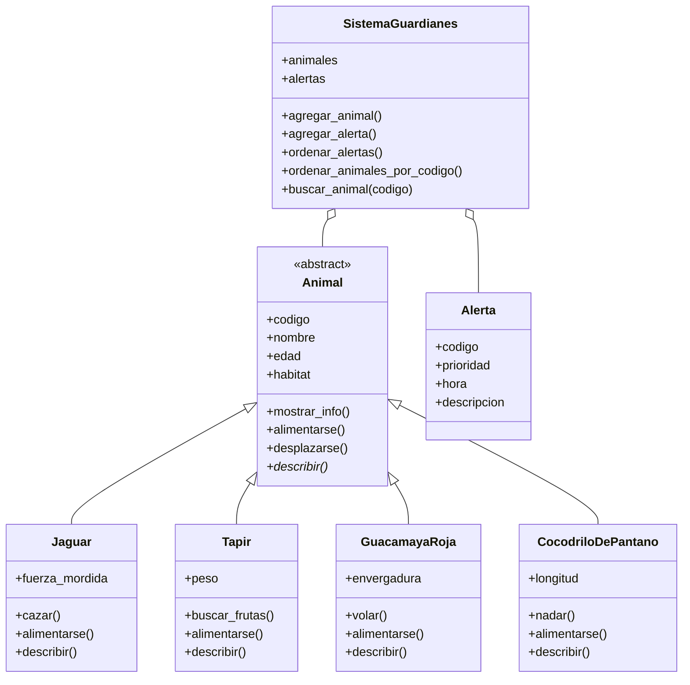
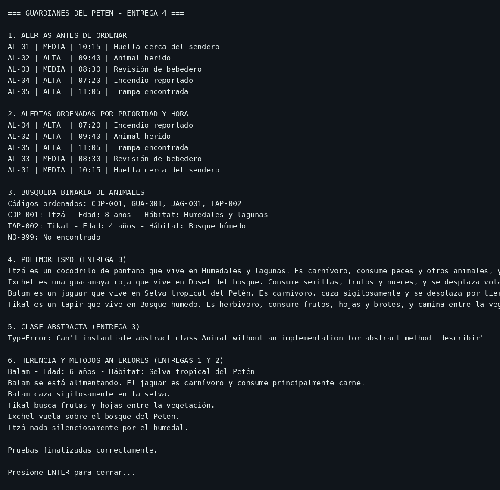

# Guardianes del Petén — Entrega 4

**Estudiante:** Axel Samuel López Ortiz  
**Carné:** 202504785  
**Grupo:** Grupo 2 – LISCC-L  
**Fecha:** 8 de noviembre de 2026

## Ejecución

Con Python 3 instalado, abre una terminal en esta carpeta y ejecuta:

```bash
python main.py
```

Al terminar, presiona ENTER para cerrar.

## Diagrama de clases actualizado



## Evidencia de ejecución



Las alertas se ordenan por **alta antes de media** y luego por **hora ascendente**, con selección manual. Los animales se ordenan por `codigo` también mediante selección, y se buscan con **búsqueda binaria**.
